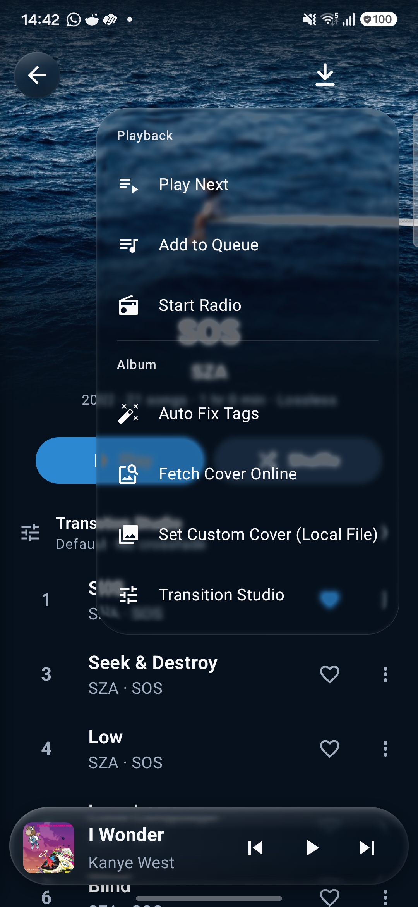

# erhu

A local music player for Android, built with Kotlin, Jetpack Compose and Media3.

## Beta 1

The first beta is available as an ARM64 APK for Android 8.0 and newer. It has been tested on a Samsung Galaxy S23 running One UI. Compatibility with other devices is still being tested.

[Download Beta 1](https://github.com/lochanpthakke/erhu/releases/tag/v1.0.2-beta.1)

Install the APK from the release page and grant music access when prompted. erhu plays music stored on your device; radio stations select tracks from your own library.

Existing installations can update in place. The application ID and signing certificate are unchanged, so an update preserves library data, preferences, favourites and playback history.

## Features

- Albums, artists, playlists, favourites and listening history.
- Smart playlists and radio stations generated from your library, with VYBE sound matching.
- Synced lyrics from embedded lyrics, cached results and LRCLIB.
- Queue management, metadata editing and artwork controls.
- Floating navigation, adjustable glass surfaces and Now Playing artwork transitions.
- Three Home screen widget styles with playback controls and resizable layouts.
- Manual update checks and a monthly automatic check for published stable releases.

The optional Musixmatch synced-lyrics provider requires a licensed API key. It is disabled when no key is configured. See [provider configuration](docs/synced-lyrics-providers.md).

## Screenshots

These saved development screenshots show the radio station screen and album menu. Updated release images will follow.

<p>
  
  
</p>

## Build

Use JDK 21, the Android SDK configured by the project and the checked-in Gradle wrapper.

```sh
./gradlew :app:assembleDebug
```

The [release workflow](.github/workflows/release.yml) runs unit tests and release lint, builds the optimized ARM64 APK, and verifies its package, version and signing certificate. Signing material is supplied through GitHub Actions Secrets.

The source namespace is `com.erhu.erhu`. The installed application ID remains `com.lochanpthakke.empee3` for compatibility with existing installations.

## Feedback

Report bugs through [GitHub Issues](https://github.com/lochanpthakke/erhu/issues). Include the device model, Android and One UI versions where relevant, app version, and steps to reproduce the problem.

## License

[GNU General Public License v3.0](LICENSE).
