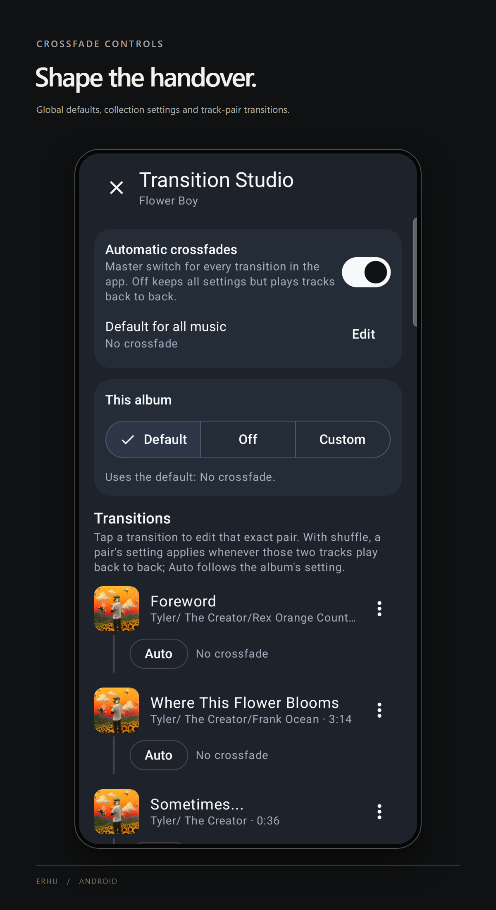
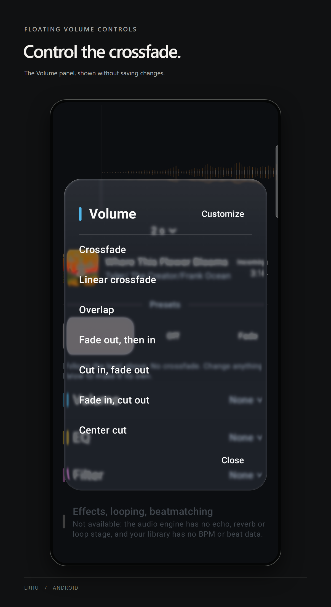

# Transition Studio

Open an album or playlist and tap **Transition Studio**. Album overflow menus also provide this action.

## Choose where the transition applies

- **Default for all music:** edit the global transition.
- **This album / This playlist:** choose Default to inherit the global setting, Off for no crossfades in that collection, or Custom for a collection-specific transition.
- **Transitions:** tap the connector between two tracks to edit that exact pair. Auto follows the collection setting. A pair's setting applies whenever those tracks play back to back, including during shuffle.

**Automatic crossfades** is the master switch. Turning it off retains the saved settings and plays tracks back to back.

## Edit a transition

Choose a preset and duration. **Volume**, **EQ** and **Filter** open dedicated floating panels. Custom volume curves expose editable points on the timeline.

For a track pair, use the preview control when available to hear the handover. Tap **Save** to apply the draft. Closing the editor without saving discards its edits. **Reset to default** removes a collection override.

Effects, looping and beatmatching are marked unavailable in the current editor; they are not part of the supported transition controls.

## About these captures

Captured from the installed erhu 1.0.2 build on a Galaxy S23 on 3 November 2026. The overview shows the existing Flower Boy album and its unchanged “No crossfade” default. The Volume panel was opened without saving a transition or starting playback. [Original captures](images/transition-studio.png).
